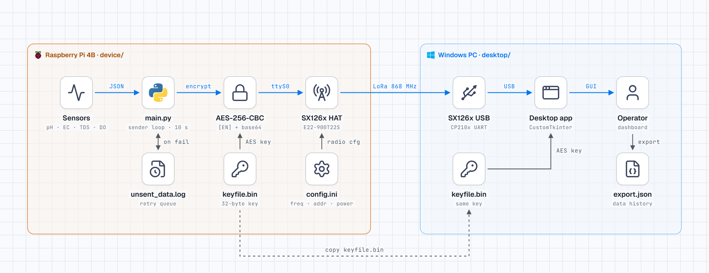
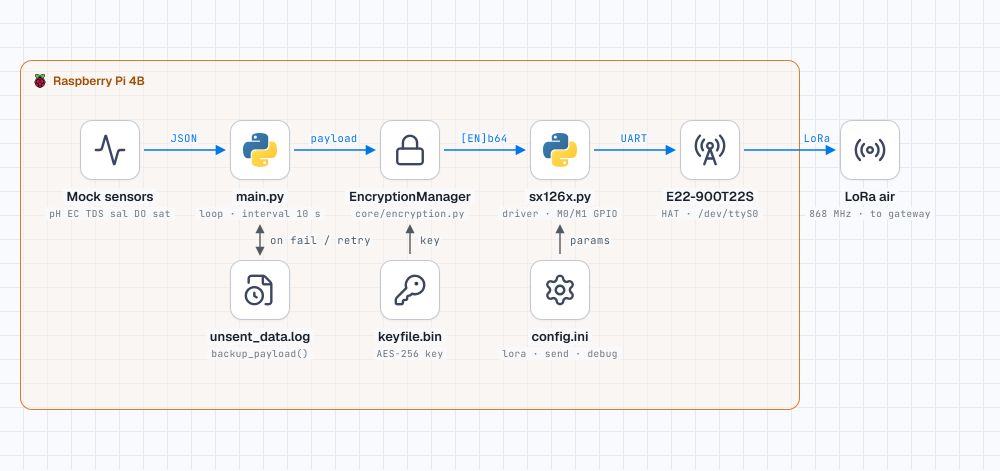
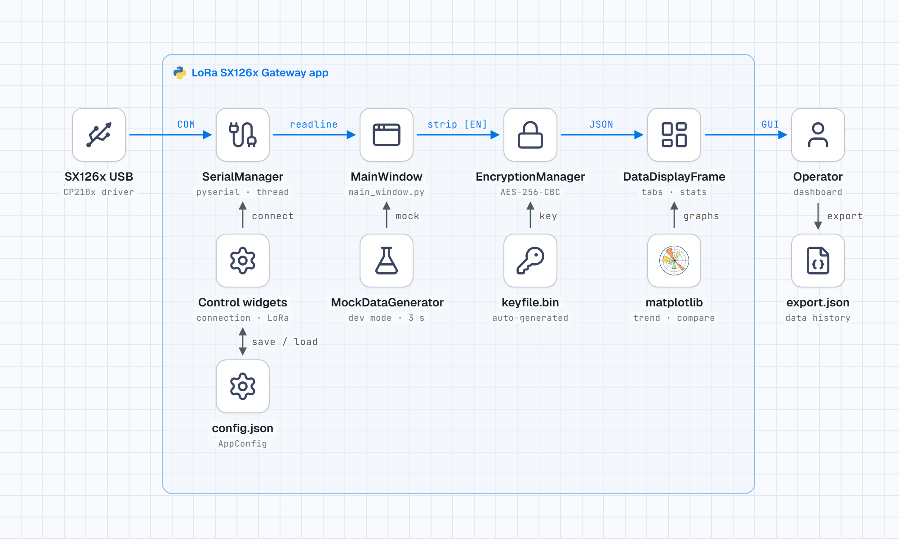

# LoRa SX126x Gateway Desktop Application

A modern desktop application built with Python 3.10 for receiving and displaying LoRa sensor data via USB UART connection.

## Features

- **Modern UI/UX**: Built with CustomTkinter for a sleek, modern interface
- **Serial Port Management**: Easy selection and configuration of USB serial ports
- **LoRa Parameter Configuration**: Configurable frequency, bandwidth, spreading factor, coding rate, and power level
- **Real-time Data Display**: Live display of incoming sensor data with multiple view modes
- **Encryption Support**: Built-in support for XOR encryption (AES support planned)
- **Mock Data Generation**: Development mode with simulated sensor data
- **Data Export**: Export received data to JSON format
- **Statistics**: Real-time statistics and analysis of received data
- **Modular Architecture**: Easily extensible for future features

## Requirements

- Python 3.10 or higher
- See `requirements.txt` for Python package dependencies

## Installation

1. Clone or download the application files
2. Install required packages:
   \`\`\`bash
   pip install -r requirements.txt
   \`\`\`

## Usage

1. Run the application:
   \`\`\`bash
   python main.py
   \`\`\`

2. **Configure Serial Connection**:
   - Select your USB serial port from the dropdown
   - Set the appropriate baudrate (default: 9600)
   - Click "Connect" to establish connection

3. **Configure LoRa Parameters**:
   - Set frequency (MHz)
   - Configure bandwidth, spreading factor, coding rate
   - Adjust power level and sync word as needed

4. **View Data**:
   - **Raw Data**: View all incoming data as received
   - **Sensor Data**: Structured view of parsed sensor readings
   - **Statistics**: Real-time statistics and analysis

5. **Development Mode**:
   - Use "Toggle Mock Data" to generate simulated sensor data
   - Useful for testing and development without hardware

## Configuration

The application automatically saves and loads configuration from `config.json`. This includes:
- Serial port settings
- LoRa parameters
- Encryption settings

## Data Format

The application expects JSON-formatted sensor data:

\`\`\`json
{
  "timestamp": 1752037883.8479893,
  "sensor_readings": {
    "pH": 7.3,
    "EC": 820,
    "TDS": 410,
    "Salinity": 0.42,
    "DO": 6.8,
    "saturation": 88.5
    },
  "location": {
    "device_id": "sensor_001",
    "site": null,
    "battery": null,
    "rssi":null,
    "coordinates": {
      "lat": null,
      "lon": null
    }
  }
}
\`\`\`

## Diagrams

### System overview

<picture>
  <source media="(prefers-color-scheme: dark)" srcset="docs/diagrams/overview-dark.png">
  
</picture>

### Sensor node (`device/`)

<picture>
  <source media="(prefers-color-scheme: dark)" srcset="docs/diagrams/device-dark.png">
  
</picture>

### Gateway desktop app (`desktop/`)

<picture>
  <source media="(prefers-color-scheme: dark)" srcset="docs/diagrams/desktop-dark.png">
  
</picture>

Diagrams made with [stack-diagram](https://github.com/caru-ini/stack-diagram). Icons: devicon / svgl / Lucide.

## Architecture

\`\`\`
src/
├── core/
│   ├── config.py          # Configuration management
│   ├── serial_manager.py  # Serial port communication
│   ├── encryption.py      # Encryption/decryption
│   └── mock_data.py       # Mock data generation
└── gui/
    ├── main_window.py     # Main application window
    └── widgets/
        ├── connection_frame.py    # Serial connection controls
        ├── lora_config_frame.py   # LoRa parameter configuration
        ├── data_display_frame.py  # Data visualization
        └── control_frame.py       # Application controls
\`\`\`

## Future Enhancements

- **Advanced Encryption**: AES encryption support
- **Data Visualization**: Real-time graphs and charts
- **Database Storage**: SQLite integration for data persistence
- **Remote Control**: Send configuration commands to LoRa devices
- **Alert System**: Configurable alerts for sensor thresholds
- **Multi-device Support**: Enhanced support for multiple LoRa devices

## Troubleshooting

### Serial Port Issues
- Ensure the USB device is properly connected
- Check that no other applications are using the serial port
- Try different baudrate settings if connection fails

### Data Not Appearing
- Verify the LoRa device is transmitting data
- Check that the data format matches the expected JSON structure
- Enable mock mode to test the application functionality

### Performance Issues
- Reduce the data transmission rate from LoRa devices
- Clear old data regularly using the "Clear" button
- Adjust the mock data interval if using development mode

## License

This project is provided as-is for educational and development purposes.
